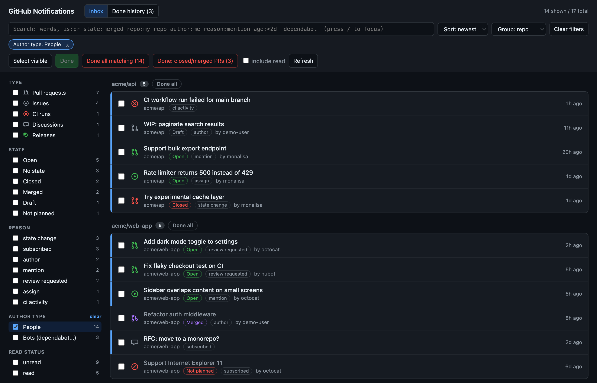

# gh-notifications

[](https://github.com/StevenPG/gh-notifications/actions/workflows/ci.yml)
[](LICENSE)


A fast, local inbox for your GitHub notifications. The notifications page on
github.com is hard to filter, so this gives you faceted filtering, search
qualifiers, PR and issue state icons, bulk **Done** actions and a history of
everything you cleared.



_Screenshot uses fake demo data (`npm run demo`)._

## Features

- **State at a glance:** icons for pull requests (open, draft, merged, closed),
  issues (open, closed, not planned), releases, discussions and CI runs
- **Faceted filters with live counts:** type, state, reason, author type
  (people vs bots), read status, age and repository
- **Search qualifiers:** `is:pr state:merged repo:api age:<2d -dependabot`
- **Hide bots by default:** Dependabot and other bots are detected from the real
  author, not just the title
- **Bulk triage:** done one at a time, by selection, by group, "all matching"
  the current filters, or every closed/merged PR in one click
- **Queued jobs:** a tab listing queued GitHub Actions jobs across your recently
  pushed repositories
- **Done history:** a searchable log of what you cleared, grouped by day
- **Private and local:** binds to `127.0.0.1`, reuses your `gh` login, no
  accounts, no telemetry, zero dependencies

## Quick start

Requirements: [Node.js](https://nodejs.org/) 18+ and the
[GitHub CLI](https://cli.github.com/) (`gh auth login`).

```sh
git clone https://github.com/StevenPG/gh-notifications.git
cd gh-notifications
npm start
```

Open <http://localhost:4777>.

Try it without a GitHub login or touching real notifications:

```sh
npm run demo
```

Use another port with `PORT=5000 npm start`.

Stop a running instance with `npm run stop` (honors `PORT`). If `npm start`
reports that the port is already in use, an older instance is still running;
stop it first so the browser talks to the current code.

### Permissions

The `gh` token needs the `notifications` scope (plus `repo` to see private
repositories). If needed: `gh auth refresh -s notifications`.

## Search qualifiers

| Qualifier | Example | Meaning |
| --- | --- | --- |
| `is:` | `is:pr`, `is:issue`, `is:unread`, `is:read`, `is:bot`, `is:draft`, `is:closed` | Quick flags |
| `state:` | `state:merged` | `open`, `draft`, `merged`, `closed`, `not_planned` |
| `type:` | `type:pr` | `pr`, `issue`, `commit`, `release`, `discussion`, `ci` |
| `repo:` | `repo:my-repo` | Repo name contains text |
| `author:` | `author:octocat`, `author:me` | Author login (`me` = PRs you authored) |
| `reason:` | `reason:mention` | Why you were notified |
| `age:` | `age:<2d`, `age:>1w` | Last updated (`h`, `d`, `w`) |
| `-term` | `-dependabot`, `-repo:docs` | Exclude |
| `"quoted"` | `"fix login"` | Phrase match |

Press `/` to focus the search box. Filters, search, sort and grouping are
remembered in your browser.

## macOS Dock shortcut

```sh
./scripts/install-mac-app.sh
```

Creates `~/Applications/GH Notifications.app` (with an icon). Drag it to your
Dock. Clicking it starts the server if needed and opens the page. The app points
at this checkout, so re-run the script if you move the repo. The app is unsigned;
on first launch right-click it and choose Open.

## How it works

A small Node server shells out to `gh api` for notifications, looks up each
PR or issue for its state and author (cached in memory), and serves a single
vanilla JS page. Marking an item done calls
`DELETE /notifications/threads/:id` and appends it to `done-log.json`.

| Method | Path | Description |
| --- | --- | --- |
| GET | `/api/notifications?all=true\|false` | Notifications with state and author |
| POST | `/api/done/:id` | Mark done (body: item metadata for history) |
| POST | `/api/read/:id` | Mark read |
| GET / DELETE | `/api/history` | Read or clear the done log |
| GET | `/api/queued-jobs?repo=owner/name` | Queued Actions jobs (`repo` optional; default scans your 30 most recently pushed repos) |

## Notes and limitations

- "Done" is permanent: GitHub has no API to undo it, so history is a record only.
- The first load can take several seconds while states are fetched.
- `done-log.json` stays on your machine (git-ignored, last 5000 entries).
- Intended for local use only; do not expose the server to a network.

## Contributing

Issues and PRs are welcome. See [CONTRIBUTING.md](CONTRIBUTING.md) and
[SECURITY.md](SECURITY.md).

## License

[MIT](LICENSE)
